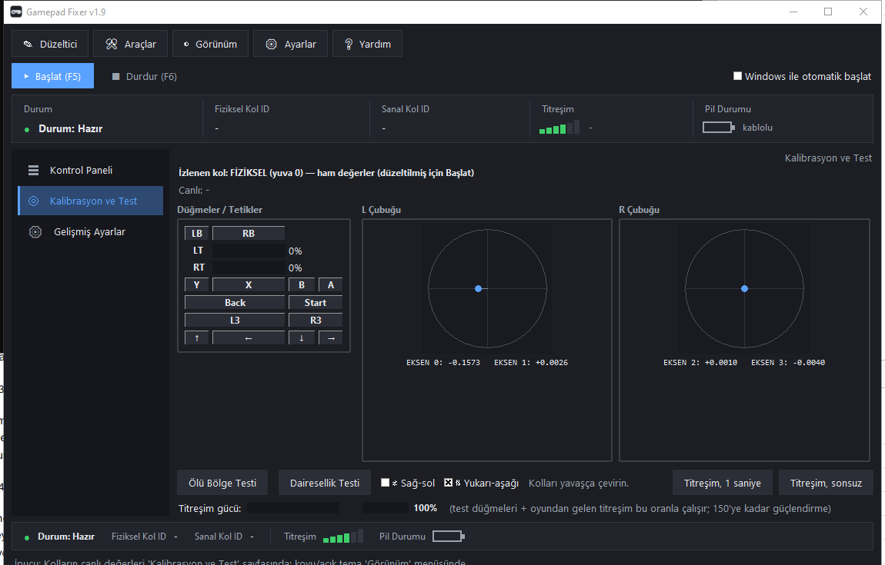
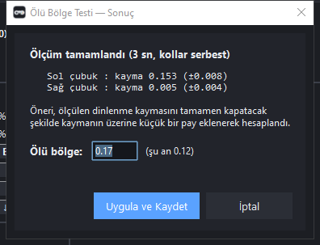

# Gamepad Fixer

Xbox kontrolcülerindeki **analog çubuk kayması (drift)** ve **ölü bölge (deadzone)** sorununu yazılımsal olarak düzelten Windows aracı.

Fiziksel kolu okur; dinlenme kaymasını otomatik telafi eder, filtreleri uygular ve sonucu **sanal bir Xbox 360 kolu** olarak sunar. Oyunlar ve test siteleri düzeltilmiş değerleri görür.



## Özellikler

- **Otomatik kayma düzeltme**: Kol başlarken ~1,3 sn'lik kalibrasyonla dinlenme kayması ölçülür ve sürekli telafi edilir. Elini çektiğinde çubuk oyunda **0** okunur.
- **Ölü Bölge Testi**: Kolları serbest bırakıp tek düğmeye basmanız yeterli. Araç 3 sn ölçer, ölçülen kaymayı **tamamen kapatan** ölü bölge değerini önerir; "Uygula ve Kaydet" dediğinizde ayarı yazıp gerekirse kol köprüsünü kendisi yeniden başlatır.

  

- **Dairesel ölü bölge** (kare değil), **dairesellik düzeltme**, **yumuşatma** ve **dead-band (crosstalk)** filtreleri — hepsi ayarlanabilir.
- **Canlı test sayfası**: düğmeler, analog çubuklar, dairesellik hatası (Avg Error) ve titreşim testi (1 sn / sürekli).
- Koyu / açık / sistem teması, sade / detaylı panel düzeni.
- Pil durumu göstergesi.
- Ayarlar kalıcıdır: `%LOCALAPPDATA%\GamepadFixer\config.json`

## Nasıl çalışır?

1. Fiziksel kol **XInput** üzerinden okunur (ayarlanabilir 30–1000 Hz).
2. Başlangıçta dinlenme kayması ölçülür ve her okumadan geri çıkarılır (bias).
3. Filtreler uygulanır: dairesel ölü bölge, dairesellik, yumuşatma, dead-band.
4. Sonuç, [ViGEm](https://github.com/nefarius/ViGEmBus) üzerinden **sanal Xbox 360 kolu (028e)** olarak sunulur.

> Not: Fiziksel kolun kendi ham sinyali donanımsaldır ve değiştirilemez. Düzeltilmiş değerler sanal kolda görünür — oyunlarda/sitelerde **sanal kolu** seçin.

## Kurulum

1. **[ViGEmBus sürücüsünü](https://github.com/nefarius/ViGEmBus/releases)** bir kez kurun (sanal kol için gerekli).
2. **[Son sürümü indirin](../../releases/latest)** → `GamepadFixer.exe`
3. Çalıştırın. SmartScreen uyarısı çıkarsa: **Daha fazla bilgi → Yine de çalıştır** (exe imzasızdır).
4. Kolu bağlayın → **Başlat (F5)**. İlk saniyelerde kolu serbest bırakın (merkez kalibrasyonu).
5. Oyun/sitede listede iki kol görünür; **Xbox 360 Controller (sanal)** olanı seçin.

### İpuçları

- Oyunun otomatik olarak sanal kolu almasını istersen: kolu kapat → **Başlat** → "Fiziksel kol bekleniyor..." yazınca kolu aç.
- Ölü bölge testini **her kol değişikliğinde** tekrar yapın; kayma koldan kola değişir.
- Test, fiziksel kolun **ham** kaymasını ölçer. Düzeltmeden sonra testi tekrar çalıştırırsanız yine yüksek değer görünür — bu normaldir. Düzelmiş sonucu sanal kolda görürsünüz (dinlenirken 0.00).
- Durdurmak için: **Durdur (F6)** ya da pencereyi kapatın.

## Kaynak koddan çalıştırma

Gereksinim: Windows 10/11, Python 3.10+.

```bash
pip install -r requirements.txt
python gamepad_fixer_gui.py
```

Tek dosya exe derlemek için:

```bash
python -m PyInstaller --noconfirm --clean --onefile --windowed --name GamepadFixer ^
  --collect-all vgamepad --hidden-import hid --icon assets\gamepad.ico ^
  --add-data "assets;assets" gamepad_fixer_gui.py
```

## SSS

- **Karakter kendi kendine yürüyordu / kamera kayıyordu, çözülür mü?**
  Evet — kayma makul aralıktaysa (≤ 0.30) tamamen sıfırlanır; daha büyük kaymalar da ölü bölgeyle kapatılır.
- **Sitede "Xbox Wireless Controller" neden hâlâ kayıyor?**
  O fiziksel kolun kendisidir; ham sinyali değiştirilemez. Düzeltilmiş hâli sanal koldur (028e).
- **Windows "bilinmeyen yayıncı" uyarısı veriyor.**
  Exe kod imzalı değil; "Yine de çalıştır" ile devam edebilirsiniz.
- **Bluetooth Xbox kolu çalışır mı?**
  Evet — kol XInput olarak göründüğü sürece (USB, Bluetooth veya Xbox Wireless Adaptör) çalışır.

## Teşekkürler

- [ViGEmBus](https://github.com/nefarius/ViGEmBus) — sanal kol altyapısı
- [vgamepad](https://github.com/yannbouteiller/vgamepad) — Python ViGEm istemcisi
